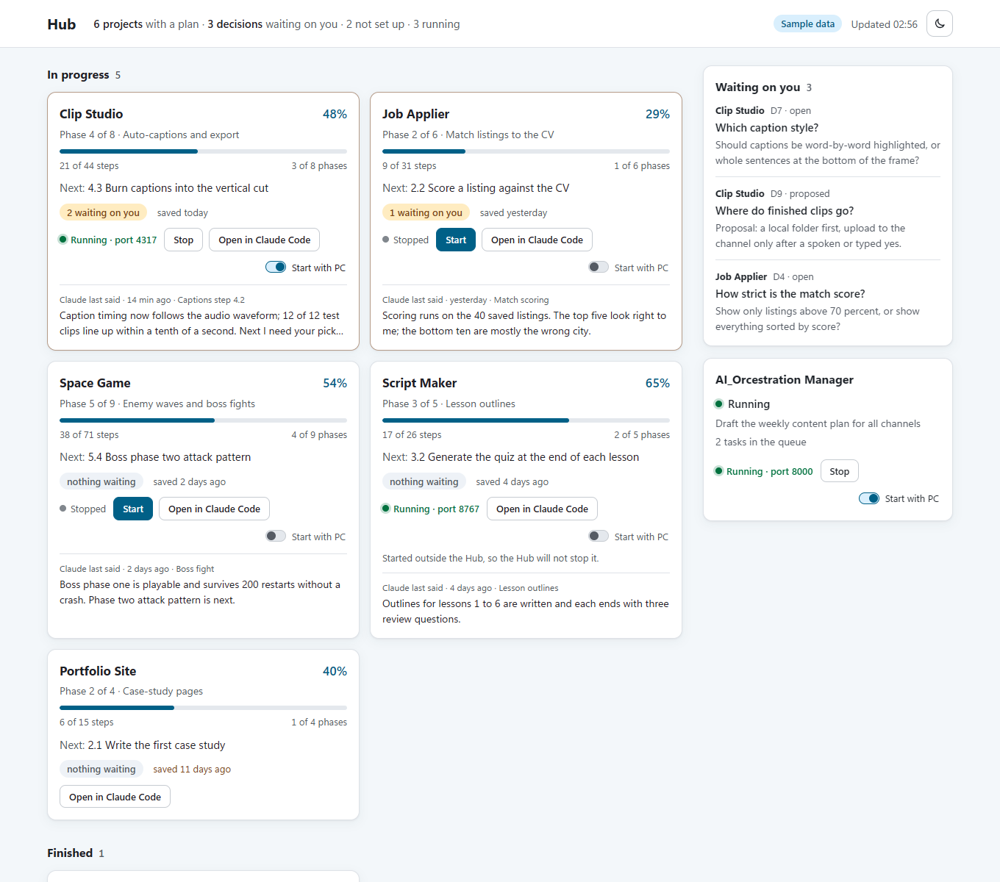
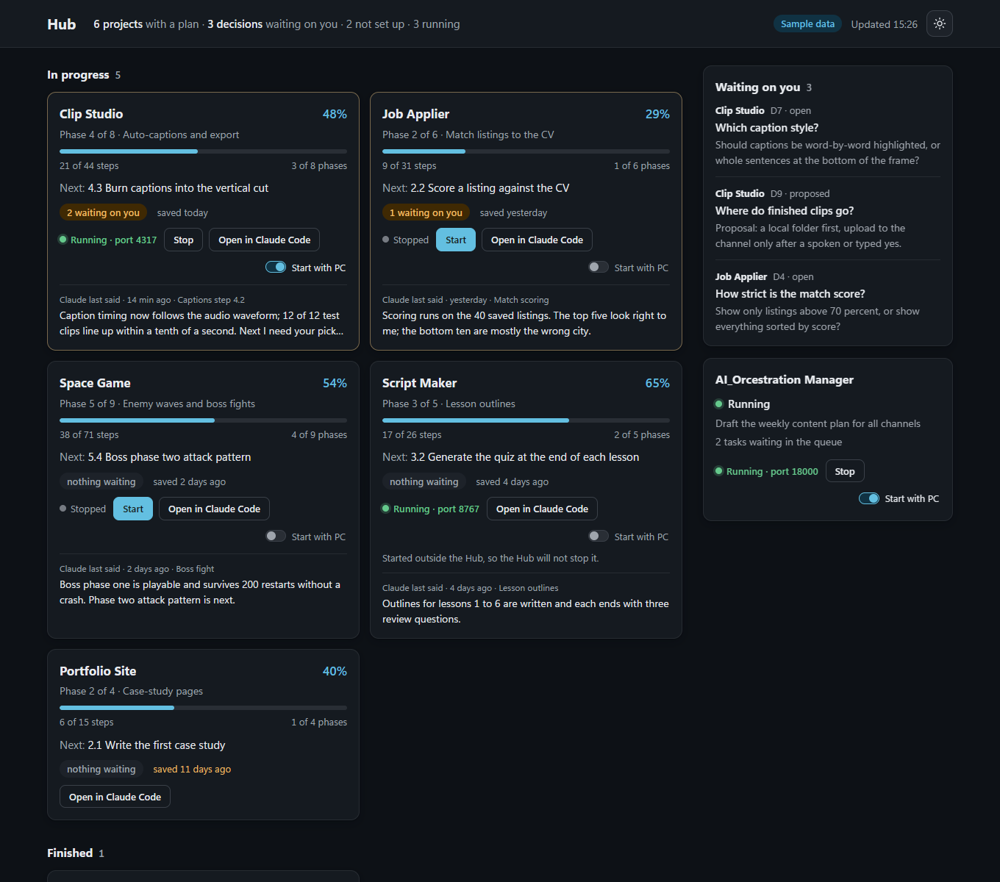
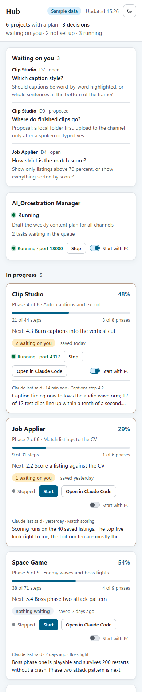

# Hub

A local dashboard that gives one-glance control over a whole folder of software projects, with an optional Jarvis-style voice assistant on top.

I run many projects side by side, each planned and built with Claude Code. Hub reads each project's own plan, decisions and chat history from disk and shows, on one page, where every project stands, what is waiting on me, and what Claude last said in each one. It never holds the answers itself; it only fetches them, read-only.



*Screenshots use made-up sample data (`--demo`), not my real projects.*

| Dark theme | Phone width |
|---|---|
|  |  |

## What the dashboard shows

- **Project cards:** progress bar, current phase, next step, decisions waiting, and how old the last save-point is. Projects with no plan yet sit in a small "not set up" group.
- **Waiting on you:** every open question across all projects in one list, with the full question text.
- **Claude's latest words:** the last thing Claude said in each project's chat, read from the saved chat files on the same PC. Click a card to expand it.
- **Manager card:** status of a separate orchestration service (running or not, queue, current goal).
- Light by default, dark by switch (remembered), refreshes itself every 30 seconds.

## Run it

Developed on Node 24. No dependencies to install. On Windows, double-click `Start Hub Dashboard.bat` in the main folder (add `demo` after the name for sample data); it starts the server and opens the page.

```bash
node tools/dashboard/server.mjs          # real data from your projects -> http://127.0.0.1:4780
node tools/dashboard/server.mjs --demo   # sample data, safe to screenshot or show
node tools/dashboard/server.mjs --selftest
```

`--demo` runs anywhere. Real mode expects a folder of projects that each keep a plan board, a decisions file and a handoff note (layout in `docs/INDEX.md`), read through my own shared reader (`~/.claude/hooks/lib/busnus.mjs`, not part of this repository).

## How it is built

- **Plain Node, no framework, no build step.** A small HTTP server (`tools/dashboard/server.mjs`) serves JSON feeds and a static page (`tools/dashboard/public/`). The page writes all text with `textContent`, never HTML, because the text comes from project files.
- **Read-only by design.** Every request is a GET; nothing on the page can change a file.
- **This PC only.** The server binds to `127.0.0.1`, rejects any other `Host` header (DNS-rebinding guard), and sends a strict Content-Security-Policy. `--selftest` checks the JSON feed, the page, refused POSTs, refused path tricks and refused foreign hosts.
- **Secrets never reach the page.** A filter replaces key-like text (API keys, tokens, `password=`, long random strings) in Claude's words and decisions with `[hidden]`.
- **Numbers come from one source.** Progress and decision counts use the same reader as my `busnus-status` command, so the dashboard and the terminal agree.
- **Design:** an Operate-style surface (calm, scannable, one accent colour, tabular numbers, visible focus, reduced-motion respected), checked with Playwright screenshots at desktop and phone width and a design linter.

## The voice layer (optional, experimental)

A Jarvis-style assistant ("Hey Jarvis, how is the game going?", "any decisions waiting?") built on top of the open-source [isair/jarvis](https://github.com/isair/jarvis), which is free for personal, non-commercial use and is **not** included in this repository. What lives here: a persona relay in front of a Gemini free-tier brain (`tools/jarvis_trial/`), read-only fetch tools that answer from project files with sentences built by code rather than by the model (`tools/hub_status/`), and a read-only helper that can hand a question to Claude (`tools/claude_bridge/`). The model only picks which fetch to run; it does not hold the answers. This part is a working trial, not the main product.

## Status and plan

The dashboard is the main product now; the voice layer is optional and developed separately. Progress, in order, is tracked in `docs/plan/BOARD.md` and every decision with its date and the reason in `docs/DECISIONS.md`.

Done: local data feed, project cards, waiting-decisions list, light/dark switch, Claude's latest words, secret filter. Next: Manager card against a live Manager, start-with-Windows, a security pass, and (later) answering decisions from the page with a read-back and confirm step.

## Repository map

| Path | What |
|---|---|
| `Start Hub Dashboard.bat` | double-click launcher (Windows) |
| `tools/dashboard/` | the dashboard: server, data readers, page, sample data |
| `tools/hub_status/` | read-only project status reader (also used by the voice layer) |
| `tools/jarvis_trial/`, `tools/claude_bridge/` | optional voice layer parts |
| `docs/` | goal, plan board, decisions, design notes, screenshots |
| `tests/` | measurement and accuracy scripts from the voice work |

## License

MIT, see `LICENSE`. This covers the code in this repository only; isair/jarvis (optional, not included) has its own licence.
